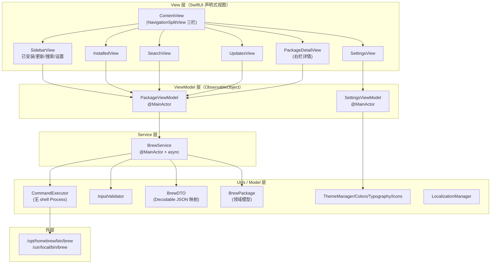
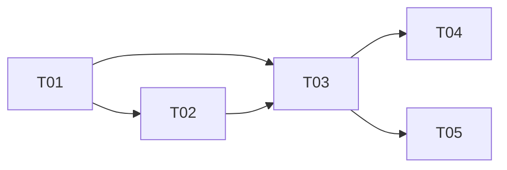

# BeeBrew 详细设计说明书（Detailed Design Document）

| 项目 | 内容 |
| --- | --- |
| 文档版本 | v1.0 |
| 编制人 | 高见远（架构师 / software-architect） |
| 上游输入 | 《BeeBrew 需求规格说明书（SRS）》`docs/01-需求规格说明书-SRS.md` |
| 技术栈 | SwiftUI + Swift Package Manager（executable target），调用 brew CLI（JSON 输出） |
| 设计原则 | 增量改造（基于现有骨架），零外部依赖，数据与 CLI 输出严格一致 |

---

## 1. 引言

### 1.1 目的

本文档在《需求规格说明书（SRS）》基础上，对 BeeBrew macOS 原生 GUI 应用进行**详细设计**：明确分层架构、模块划分、接口签名、Decodable 数据结构（映射 brew `--json=v2` 真实输出）、技术实现方案（异步并发/进度回调/命令注入防护），并给出可直接指导工程师逐文件实现的有序任务列表。

### 1.2 范围

- **包含**：MVP 全部 P0 功能（FR-001 ~ FR-018），以及 P1 中影响架构的排序/筛选/空状态/错误状态（FR-019/020/027）在数据模型层的预留。
- **不包含**：P2 功能（FR-028 ~ FR-033：Tap/服务/Bundle/诊断/多语言/版本回退），仅在设计上不阻塞、不预留复杂抽象。

### 1.3 参考文档

| 文档 | 用途 |
| --- | --- |
| `docs/01-需求规格说明书-SRS.md` | 功能与非功能需求基线（FR-xxx / NFR-xxx 编号来源） |
| Homebrew 官方 JSON 输出（`brew <cmd> --json=v2`） | 接口与 DTO 字段映射的事实来源 |
| 现有代码骨架（`Package.swift`、`beebrew/**`、`Tests/**`） | 增量设计的基础 |

### 1.4 与 SRS 的追溯关系

本文档所有设计决策均通过 **FR-xxx / NFR-xxx** 编号引用 SRS，具体追溯矩阵见各章节内联标注（如「[FR-002]」）。核心追溯汇总：

| 需求域 | 设计落点 |
| --- | --- |
| FR-001 环境检测 | `BrewService.detectEnvironment()` + `CommandExecutor` |
| FR-002/003 已安装列表 | `listInstalledFormulae()/listInstalledCasks()` → `brew list --json=v2` |
| FR-005 搜索 | `search()` → `brew search --json=v2` + ViewModel 300ms 防抖 |
| FR-006~011 包操作 | `install/uninstall/upgrade/upgradeAll` 流式执行 |
| FR-012 批量操作 | `PackageViewModel.bulkUninstall/bulkUpgrade` + `Set<String>` 选中集 |
| FR-013 详情 | `PackageDetailView` + `getFormulaInfo/getCaskInfo` |
| FR-014 进度反馈 | `OperationLogEntry` + `AsyncStream<StreamEvent>` |
| FR-015/016 系统维护 | `updateHomebrew/cleanupDryRun/cleanup` |
| FR-017/018 设置 | `SettingsViewModel`（brew 路径联动 CommandExecutor）+ `ThemeManager` |
| NFR-008 注入防护 | `InputValidator` + 无 shell 直接 Process 调用 |
| NFR-011 不阻塞 UI | 后台队列 + `@MainActor` + 流式 |
| NFR-013 数据一致 | DTO 与 `--json=v2` 字段逐一映射，不臆造字段 |

### 1.5 现有骨架 → 目标设计的 5 个关键改造点

（对应团队负责人指出的「关键差距」，本文档逐一给出落地方案）

| # | 现状问题 | 本文档方案 | 落点章节 |
| --- | --- | --- | --- |
| G1 | `BrewService` 用文本解析（`list --versions`/正则） | 全面改为 `--json=v2` + `Decodable` DTO 解析 | §4、§5 |
| G2 | `PackageViewModel.loadInitialData` 用 `samplePackages` | 改为 `Task` 异步调用真实 brew 命令 | §4.3、§6 |
| G3 | `UpdatesView`/`SystemStatusView` 是占位；右栏详情缺失 | 新增 `UpdatesView`（真实 outdated）+ `PackageDetailView`（右栏 300px） | §3、§7 |
| G4 | 侧边栏 `AppTab` 为「探索/已安装/更新/系统」 | 对齐 SRS 为「已安装/更新(⑦Badge)/搜索/设置」 | §3.2、§7 |
| G5 | `Package.swift` 声明 macOS 12+ | 升级为 macOS 14+（NFR-004） | §9、§7 |

---

## 2. 系统架构设计

### 2.1 整体分层架构

采用「**View → ViewModel → Service → Utils → brew CLI**」四层单向数据流架构（MVVM 变体），无外部框架依赖。



**数据流方向（单向）**：用户操作 → View 调用 ViewModel 方法 → ViewModel 触发 Service async 方法 → Service 通过 CommandExecutor 执行 brew CLI → Service 用 BrewDTO 解码 JSON → 映射为 BrewPackage → 回写 ViewModel 的 `@Published` 状态 → SwiftUI 自动刷新 View。

```mermaid
flowchart LR
    User["用户操作/输入"] --> View["View"]
    View -->|"方法调用"| VM["ViewModel @Published"]
    VM -->|"async 调用"| Svc["BrewService"]
    Svc -->|"executeBrew JSON/Stream"| Cmd["CommandExecutor"]
    Cmd -->|"Process (args 数组)"| Brew["brew CLI --json=v2"]
    Brew -->|"stdout JSON"| DTO["BrewDTO Decodable"]
    DTO -->|"mapToBrewPackage()"| Model["BrewPackage"]
    Model -->|"@Published 赋值"| VM
    VM -->|"SwiftUI 响应式刷新"| View
```



### 2.2 三栏布局设计（macOS 14 `NavigationSplitView`）

SRS 要求三栏：**左导航 180px（可折叠 64px）/ 中列表 flex / 右详情 300px（可拖拽）**，窗口最小 900×600。

- 使用 macOS 13+ 提供的 `NavigationSplitView(sidebar:content:detail:)` 三栏结构，天然支持侧边栏折叠与详情栏拖拽。
- 左侧 `SidebarView`：4 个导航项（已安装 / 更新·Badge / 搜索 / 设置），对应快捷键 Cmd+1/2/3/逗号。
- 中间 `content`：按当前导航项切换 `InstalledView / UpdatesView / SearchView / SettingsView`。
- 右侧 `detail`：`PackageDetailView`，展示当前 `selectedPackage` 的完整信息（FR-013）。

---

## 3. 模块划分

| 模块 | 职责 | 所属文件 | 对应 FR |
| --- | --- | --- | --- |
| 应用入口 | `@main`，注入环境对象，应用快捷键，设置最小窗口尺寸 | `beebrew/App/beebrewApp.swift` | NFR-003/004 |
| 根视图/三栏容器 | `NavigationSplitView` 三栏，导航切换，搜索聚焦 | `beebrew/Views/Content/ContentView.swift` | FR-004/005 |
| 侧边栏导航 | 4 导航项 + 更新 Badge + 统计 | `beebrew/Views/Content/SidebarView.swift` | FR-004/010 |
| 已安装列表 | Formula/Cask 分类 Tab、复选、批量卸载/升级 | `beebrew/Views/Packages/InstalledView.swift` | FR-002/003/004/012 |
| 搜索列表 | 搜索框 + 结果表格 + 空/错误态 | `beebrew/Views/Packages/SearchView.swift` | FR-005/027 |
| 列表行组件 | 复选框24/名称flex/版本80/大小80/状态60 统一表格行 | `beebrew/Views/Packages/PackageRowView.swift` | FR-012/019/020 |
| 详情面板 | 右栏 300px：描述/版本/依赖/主页/操作 | `beebrew/Views/Detail/PackageDetailView.swift` | FR-013/023 |
| 更新/系统维护 | outdated 列表 + 全升/单升 + 更新 Homebrew + 清理预览 | `beebrew/Views/Updates/UpdatesView.swift` | FR-010/011/015/016 |
| 设置 | Homebrew 路径（FR-017）+ 主题（FR-018）+ 通用 | `beebrew/Views/Settings/SettingsView.swift` | FR-017/018 |
| 包视图模型 | 列表/搜索/详情/操作/批量/进度 状态编排 | `beebrew/ViewModels/PackageViewModel.swift` | FR-004/005/012/014, NFR-001/002 |
| 设置视图模型 | brew 路径解析/持久化/主题联动 | `beebrew/ViewModels/SettingsViewModel.swift` | FR-017/018 |
| 服务层 | 全部 brew CLI 调用 + JSON 解析 + 流式进度 | `beebrew/Services/BrewService.swift` | FR-001~016 |
| 数据模型 | 领域模型 + JSON DTO + 环境信息 | `beebrew/Models/BrewPackage.swift`、`BrewDTO.swift`、`BrewEnvironment.swift` | NFR-013 |
| 命令执行器 | 无 shell Process、JSON 解码、流式 | `beebrew/Utils/CommandExecutor.swift` | NFR-008/011 |
| 输入校验 | 包名/路径白名单校验 | `beebrew/Utils/InputValidator.swift` | NFR-008 |
| 错误定义 | 统一错误类型 | `beebrew/Utils/BrewError.swift` | NFR-012 |
| 主题/本地化/样式 | 色彩/字体/图标/多语言 | `beebrew/Utils/*.swift` | FR-018 |

---

## 4. 接口设计

### 4.1 CommandExecutor（工具层）

改造要点：**移除 `/bin/bash -c` 拼接**，改用 `Process` 直接以 `executableURL` + `arguments` 数组执行（NFR-008）；brew 路径可配置（FR-017）。

```swift
struct ExecutionResult {
    let stdout: String
    let stderr: String
    let exitCode: Int32
    var isSuccess: Bool { exitCode == 0 }
}

enum StreamEvent {
    case stdout(String)   // brew 标准输出片段
    case stderr(String)   // brew 错误/进度输出片段
    case exit(Int32)      // 结束事件（退出码）
}

final class CommandExecutor {
    static let shared = CommandExecutor()
    private(set) var brewPath: String   // 由 SettingsViewModel 注入，默认自动检测

    // 核心：直接以参数数组执行（无 shell）
    func run(executableURL: URL, arguments: [String]) async throws -> ExecutionResult

    // brew 专用：自动拼接 brewPath
    func runBrew(arguments: [String]) async throws -> ExecutionResult

    // brew JSON 解码：async 版本（对应现有 executeAndParseJSON<T> 的异步化）
    func runBrewJSON<T: Decodable>(_ type: T.Type, arguments: [String]) async throws -> T

    // brew 流式执行：用于长操作进度（install/uninstall/upgrade/update/cleanup）
    func runBrewStreaming(arguments: [String]) -> AsyncThrowingStream<StreamEvent, Error>

    // 环境检测（FR-001）
    func detectBrewPath() -> String?            // 依次：Settings 自定义 → which brew → /opt/homebrew → /usr/local
    func brewVersion() async throws -> String   // brew --version
    func brewPrefix() async throws -> String    // brew --prefix
}
```

> 说明：`runBrewJSON` 内部调用 `runBrew(arguments: [..., "--json=v2"])`，用 `JSONDecoder` 解码 `T`，解码失败抛 `BrewError.jsonDecode`。`runBrewStreaming` 内部用 `Pipe.fileHandleForReading.readabilityHandler` 将数据流转换为 `AsyncThrowingStream`，结束事件 `.exit(code)` 后关闭流。

### 4.2 BrewService（服务层）

```swift
@MainActor
final class BrewService: ObservableObject {
    // 状态
    @Published private(set) var isHomebrewInstalled: Bool
    @Published private(set) var homebrewVersion: String
    @Published private(set) var isLoading: Bool
    @Published private(set) var lastError: BrewError?
    @Published private(set) var operationLog: [OperationLogEntry]   // 长操作日志（FR-014）
    @Published private(set) var runningOperations: Set<String>       // 进行中的操作标识（包标识或系统操作名）

    // ---- 环境（FR-001） ----
    func detectEnvironment() async -> BrewEnvironment        // brew --version + --prefix + config

    // ---- 列表（FR-002/003/010） ----
    func listInstalledFormulae() async throws -> [BrewPackage]  // brew list --formula --json=v2
    func listInstalledCasks()    async throws -> [BrewPackage]  // brew list --cask   --json=v2
    func listInstalled()         async throws -> [BrewPackage]  // 并发合并上述两者
    func listOutdated()          async throws -> [BrewPackage]  // brew outdated --json=v2

    // ---- 搜索（FR-005） ----
    func search(query: String) async throws -> [BrewPackage]   // brew search --json=v2 <query>

    // ---- 详情（FR-013） ----
    func getFormulaInfo(_ name: String)  async throws -> BrewPackage  // brew info --json=v2 <name>
    func getCaskInfo(_ token: String)    async throws -> BrewPackage  // brew info --cask --json=v2 <token>

    // ---- 包操作（FR-006/007/008/009/011） ----
    func install(_ pkg: BrewPackage)   async throws   // brew install [--cask] <name>   (流式)
    func uninstall(_ pkg: BrewPackage) async throws   // brew uninstall [--cask] <name> (流式)
    func upgrade(_ pkg: BrewPackage)   async throws   // brew upgrade [--cask] <name>   (流式)
    func upgradeAll()                  async throws   // brew upgrade                    (流式)

    // ---- 系统维护（FR-015/016） ----
    func updateHomebrew() async throws                  // brew update (流式)
    func cleanupDryRun() async throws -> [CleanupItem]  // brew cleanup --dry-run（文本解析）
    func cleanup() async throws                         // brew cleanup (流式)
}
```

**每个方法的 brew CLI 与 JSON 结构对应关系**：

| 方法 | brew 命令 | 解析结构 | 输出 |
| --- | --- | --- | --- |
| `detectEnvironment` | `brew --version` / `--prefix` / `config` | 文本 | `BrewEnvironment` |
| `listInstalledFormulae` | `brew list --formula --json=v2` | `BrewFormulaListJSON` | `[BrewPackage]` |
| `listInstalledCasks` | `brew list --cask --json=v2` | `BrewCaskListJSON` | `[BrewPackage]` |
| `listOutdated` | `brew outdated --json=v2` | `BrewOutdatedJSON` | `[BrewPackage]` |
| `search` | `brew search --json=v2 <q>` | `[BrewSearchItem]` | `[BrewPackage]` |
| `getFormulaInfo` | `brew info --json=v2 <name>` | `BrewFormulaListJSON` | `BrewPackage` |
| `getCaskInfo` | `brew info --cask --json=v2 <token>` | `BrewCaskListJSON` | `BrewPackage` |
| `install/uninstall/upgrade/upgradeAll/updateHomebrew/cleanup` | 对应子命令（流式） | 文本行 → `operationLog` | `throws` / `Void` |
| `cleanupDryRun` | `brew cleanup --dry-run` | 文本行 | `[CleanupItem]` |

### 4.3 PackageViewModel（视图模型层）

```swift
@MainActor
final class PackageViewModel: ObservableObject {
    // 数据
    @Published var installedPackages: [BrewPackage]      // FR-002/003
    @Published var outdatedPackages: [BrewPackage]       // FR-010
    @Published var searchResults: [BrewPackage]          // FR-005
    @Published var selectedPackages: Set<String>         // FR-012（键 = package.id）
    @Published var selectedPackage: BrewPackage?         // FR-013 详情选中
    @Published var packageDetail: BrewPackage?           // FR-013
    @Published var currentTab: AppTab                     // 侧边栏当前项
    @Published var filter = PackageFilter()               // FR-019/020
    @Published var isLoading / isSearching / errorMessage

    // 操作状态（键 = package.id）
    @Published var packageOperations: [String: PackageOperationState]

    // 初始化（改造 G2：真实加载）
    init() { setupSearchDebounce(); Task { await loadInitialData() } }

    func loadInitialData() async              // 并发 listInstalled + listOutdated（NFR-001 <500ms）
    func loadInstalledPackages() async        // FR-002/003
    func checkForUpdates() async              // FR-010
    func performSearch(query: String) async   // FR-005（300ms 防抖）
    func loadPackageDetail(_ pkg: BrewPackage) async  // FR-013

    // 操作（FR-006~012/014）
    func install(_ pkg: BrewPackage) async
    func uninstall(_ pkg: BrewPackage) async
    func upgrade(_ pkg: BrewPackage) async
    func upgradeAll() async
    func bulkUninstall(_ pkgs: [BrewPackage]) async   // FR-012 串行
    func bulkUpgrade(_ pkgs: [BrewPackage]) async     // FR-012 串行

    // 系统维护（FR-015/016）
    func updateHomebrew() async
    func cleanupDryRun() async -> [CleanupItem]
    func cleanup() async
}
```

> 搜索防抖沿用现有 `$searchQuery.debounce(300ms)` 的 Combine 实现（NFR-002），仅把 `performSearch` 的数据源改为 `brewService.search`。所有方法标注 `@MainActor`，跨线程回写统一在 `await` 边界内完成。

### 4.4 错误模型

```swift
enum BrewError: LocalizedError, Equatable {
    case brewNotFound
    case invalidPackageName(String)          // NFR-008
    case invalidPath(String)                 // NFR-008
    case commandFailed(cmd: String, code: Int32, stderr: String)  // NFR-012
    case jsonDecode(String)
    case notInstalled                       // 未安装时操作
    var errorDescription: String? { get }   // 面向用户的中文描述
}
```

---

## 5. 数据结构设计

### 5.1 领域模型 BrewPackage（改造后）

现有 `id = UUID()` 不稳定（导致 Equatable 失效、`Set<UUID>` 选中错乱），改造为**稳定标识 `id = "type:name"`**，并新增与 brew JSON 对齐的字段。

```swift
struct BrewPackage: Identifiable, Codable, Equatable, Hashable {
    var id: String { "\(type.rawValue):\(name)" }   // 稳定标识，如 "formula:python" / "cask:google-chrome"

    let name: String                 // formula.name / cask.token
    let type: PackageType            // .formula / .cask
    let fullName: String?            // full_name / full_token
    let desc: String?                // desc
    let homepage: String?            // homepage
    let license: String?             // license（仅 formula）
    let version: String?             // 展示版本（formula: versions.stable；cask: version）
    let installedVersions: [String]  // formula: installed[].version；cask: [installed]
    let currentVersion: String?      // outdated 时的新版本（current_version）
    let installed: Bool
    let outdated: Bool
    let pinned: Bool                 // 仅 formula
    let kegOnly: Bool                // 仅 formula
    let autoUpdates: Bool            // 仅 cask
    let caveats: String?             // 注意事项
    let installedTime: Date?         // installed[0].time / installed_time（epoch 秒）
    let installedAsDependency: Bool  // 仅 formula
    let installedOnRequest: Bool     // 仅 formula
    let dependencies: [String]       // formula.dependencies（FR-023 依赖展示）
    let buildDependencies: [String]  // formula.build_dependencies

    // 计算属性
    var installedVersion: String? { installedVersions.first }
    var displayVersion: String { installedVersion ?? version ?? "未知版本" }
    var isFormula: Bool { type == .formula }

    // 仅 SwiftUI Preview 使用（生产路径移除）
    static var preview: [BrewPackage] { get }
}
```

> 移除/降级现有 demo 字段 `popularity / isFeatured / isVerified / category / samplePackages / Dependency(带 version) / InstallInfo / BuildInfo`：这些字段**无法映射到 brew JSON**（违反 NFR-013），MVP 不再使用；`PackageCategory` 若需保留仅用于 UI 装饰（按名称猜测），不参与数据一致性判断。`Equatable/Hashable` 由 `(name, type)` 决定。

### 5.2 JSON DTO（Decodable，新增 `beebrew/Models/BrewDTO.swift`）

```swift
// ---- brew list --formula --json=v2 / brew info --json=v2 的根 ----
struct BrewFormulaListJSON: Decodable { let formulae: [BrewFormulaJSON] }
struct BrewFormulaJSON: Decodable {
    let name: String
    let fullName: String?
    let desc: String?
    let homepage: String?
    let license: String?
    let versions: BrewVersions?
    let dependencies: [String]?
    let buildDependencies: [String]?
    let installed: [BrewInstalledEntry]?
    let outdated: Bool?
    let pinned: Bool?
    let kegOnly: Bool?
    let caveats: String?
}
struct BrewVersions: Decodable { let stable: String?; let head: String?; let bottle: Bool? }
struct BrewInstalledEntry: Decodable {
    let version: String?
    let time: Int64?                      // epoch 秒
    let installedAsDependency: Bool?
    let installedOnRequest: Bool?
}

// ---- brew list --cask --json=v2 / brew info --cask --json=v2 的根 ----
struct BrewCaskListJSON: Decodable { let casks: [BrewCaskJSON] }
struct BrewCaskJSON: Decodable {
    let token: String
    let fullToken: String?
    let name: [String]?
    let desc: String?
    let homepage: String?
    let version: String?
    let installed: String?
    let installedTime: Int64?
    let outdated: Bool?
    let autoUpdates: Bool?
    let caveats: String?
}

// ---- brew outdated --json=v2 ----
struct BrewOutdatedJSON: Decodable {
    let formulae: [BrewOutdatedFormula]?
    let casks: [BrewOutdatedCask]?
}
struct BrewOutdatedFormula: Decodable {
    let name: String
    let installedVersions: [String]?
    let currentVersion: String?
    let pinned: Bool?
    let pinnedVersion: String?
}
struct BrewOutdatedCask: Decodable {
    let name: String
    let installedVersions: [String]?
    let currentVersion: String?
}

// ---- brew search --json=v2（防御式：formula 用 name，cask 用 token） ----
struct BrewSearchItem: Decodable {
    let name: String?       // formula
    let token: String?      // cask
    let fullName: String?
    let fullToken: String?
    let tap: String?
    let desc: String?
    let homepage: String?
    let version: String?
    // 计算
    var identifier: String { token ?? name ?? "" }
    var isCask: Bool { token != nil }
}
```

### 5.3 领域辅助类型

```swift
struct BrewEnvironment {          // FR-001
    var version: String = ""      // brew --version
    var prefix: String = ""       // brew --prefix
    var repository: String = ""   // brew config: HOMEBREW_REPOSITORY
    var cellar: String = ""       // brew config: HOMEBREW_CELLAR
    var cpu: String = ""          // brew config: CPU
    var os: String = ""           // brew config: OS
}

struct CleanupItem: Identifiable {  // FR-016 清理预览
    var id: String { path }
    let path: String
    let isDryRun: Bool
}

struct OperationLogEntry: Identifiable {  // FR-014
    let id = UUID()
    let stream: Stream    // .stdout / .stderr
    let text: String
    let timestamp: Date
}
```

### 5.4 BrewPackage 字段 ↔ brew JSON 映射关系表（NFR-013）

| BrewPackage 字段 | 类型 | Formula 来源字段（JSON path） | Cask 来源字段（JSON path） |
| --- | --- | --- | --- |
| name | String | `formulae[].name` | `casks[].token` |
| type | PackageType | 固定 `.formula` | 固定 `.cask` |
| fullName | String? | `full_name` | `full_token` |
| desc | String? | `desc` | `desc` |
| homepage | String? | `homepage` | `homepage` |
| license | String? | `license` | —（无，nil） |
| version | String? | `versions.stable` | `version` |
| installedVersions | [String] | `installed[].version` | `[installed]` |
| currentVersion | String? | outdated：`current_version` | outdated：`current_version` |
| installed | Bool | `installed` 非空 | `installed != nil` |
| outdated | Bool | `outdated` | `outdated` |
| pinned | Bool | `pinned` | —（false） |
| kegOnly | Bool | `keg_only` | —（false） |
| autoUpdates | Bool | —（false） | `auto_updates` |
| caveats | String? | `caveats` | `caveats` |
| installedTime | Date? | `installed[0].time`（epoch 秒） | `installed_time`（epoch 秒） |
| installedAsDependency | Bool | `installed[0].installed_as_dependency` | —（false） |
| installedOnRequest | Bool | `installed[0].installed_on_request` | —（false） |
| dependencies | [String] | `dependencies` | —（[]） |
| buildDependencies | [String] | `build_dependencies` | —（[]） |

> 所有 Decodable 字段一律声明为可选（`?`）或带默认值，避免 brew 不同版本字段缺失导致解码崩溃（NFR-005/012）。`installed_time`/`time` 为 Unix 秒，映射为 `Date(timeIntervalSince1970:)`。

---

## 6. 技术实现说明

### 6.1 brew CLI JSON 交互方式

- 统一在 `CommandExecutor.runBrewJSON` 中追加 `--json=v2`，用 `JSONDecoder` 解码对应 `BrewDTO`。
- `brew list/info` 区分 formula/cask：formula 用 `--formula`（或直接子命令），cask 用 `--cask`。
- `brew outdated --json=v2` 返回 `{formulae, casks}` 两部分，分别映射后合并，`outdated=true` 标记。
- 解码失败抛出 `BrewError.jsonDecode`，不向 UI 传播崩溃（NFR-012）。

### 6.2 异步并发模型

- **并发读取**：`listInstalled()` 用 `async let` 并发执行 `listInstalledFormulae()` 与 `listInstalledCasks()`，满足 NFR-001（<500ms）。
- **串行写入**：包操作（install/uninstall/upgrade）在 ViewModel 层对每个包加 `packageOperations[id]` 防重入；批量操作按顺序 `for await` 串行执行，避免 brew 锁冲突（FR-012）。
- **主线程隔离**：`BrewService`、`PackageViewModel`、`SettingsViewModel` 均标注 `@MainActor`；`CommandExecutor` 的进程执行在 `Task.detached`/后台队列，只有结果回写回到主 actor。杜绝 UI 阻塞（NFR-011）。

### 6.3 进度回调机制（FR-014）

- 长操作使用 `runBrewStreaming` 返回 `AsyncThrowingStream<StreamEvent, Error>`。
- `BrewService` 消费流：将 `.stdout/.stderr` 片段追加到 `operationLog`，将操作标识加入 `runningOperations`；收到 `.exit(code)` 后移除标识，code != 0 时抛 `commandFailed`。
- UI 侧在 `UpdatesView`/`InstalledView` 底部渲染一个**操作进度面板**（`ProgressView` + 最近日志滚动），实现「操作反馈 <1s」（NFR-002）。

### 6.4 错误处理策略（NFR-012）

- 所有 brew 调用 `throws`，错误统一为 `BrewError`；ViewModel `do/catch` 后写 `errorMessage`，View 在空态/横幅展示。
- CLI 退出码非 0 不导致崩溃，`stderr` 末尾 500 字符并入 `commandFailed.stderr` 供用户诊断。
- 网络超时/权限等以 `commandFailed` 归类，提示「无需 sudo」（NFR-006）。

### 6.5 命令注入防护（NFR-008）

- **移除 shell**：`CommandExecutor.run` 直接 `Process.executableURL = URL(fileURLWithPath: brewPath)`，`arguments` 为数组，绝不经过 `/bin/bash -c` 字符串拼接。
- **包名白名单**：`InputValidator.validatePackageName` 使用正则 `^[A-Za-z0-9][A-Za-z0-9@._+/-]{0,255}$`，天然排除 `; | & $ \` > < ( )` 等 shell 元字符。
- **查询清洗**：`search` 查询词 `trim` + 截断到 100 字符 + 移除控制字符。
- **路径白名单**：`validateBrewPath` 仅接受绝对路径且 `FileManager.fileExists` 为真，禁止相对路径与符号链接外跳。

---

## 7. 任务分解（有序）

> 约束：≤5 个任务，每任务 ≥3 文件，首任务为项目基础设施；T04/T05 均仅依赖 T03，可并行。

| 任务 | 名称 | 依赖 | 文件 | 覆盖 FR/NFR |
| --- | --- | --- | --- | --- |
| **T01** | 项目基础设施 + 数据模型层（DTO/领域模型/命令执行器） | 无 | 见下 | FR-001, NFR-004/005/008/013 |
| **T02** | 服务层重构（BrewService JSON 化 + 测试） | T01 | 见下 | FR-002/003/005/006~011/013/015/016 |
| **T03** | 视图模型层改造（真实加载/进度/批量/路径联动） | T01, T02 | 见下 | FR-004/012/014/017, NFR-001/002/011 |
| **T04** | 三栏布局 + 侧边栏 + 列表视图 | T03 | 见下 | FR-002/003/004/005/012/019/020/027, NFR-003 |
| **T05** | 详情面板 + 更新/系统维护 + 设置对齐 + 测试收尾 | T03（可与 T04 并行） | 见下 | FR-010/011/013/015/016/017/018 |

**T01 文件**：
- `Package.swift`（平台 `.macOS(.v14)`，NFR-004）
- `beebrew/Models/BrewDTO.swift`（新增，§5.2 全部 DTO）
- `beebrew/Models/BrewEnvironment.swift`（新增，`BrewEnvironment` + `CleanupItem` + `OperationLogEntry`）
- `beebrew/Models/BrewPackage.swift`（改造：稳定 `id`、字段对齐、移除 demo 字段，§5.1）
- `beebrew/Utils/CommandExecutor.swift`（改造：无 shell、`runBrewJSON`/`runBrewStreaming`、brew 路径）
- `beebrew/Utils/InputValidator.swift`（新增，§6.5）
- `beebrew/Utils/BrewError.swift`（新增，§4.4）

**T02 文件**：
- `beebrew/Services/BrewService.swift`（全面重写为 §4.2 签名，JSON 解析 + 流式）
- `Tests/beebrewTests/BrewServiceJSONTests.swift`（新增：用本地 JSON fixture 测 DTO 解码与映射）
- `Tests/beebrewTests/TestFixtures/*.json`（新增：`brew list/outdated/info/search` 的 fixture）

**T03 文件**：
- `beebrew/ViewModels/PackageViewModel.swift`（改造：`loadInitialData` 真实调用、`Set<String>` 选中、批量、进度日志订阅）
- `beebrew/ViewModels/SettingsViewModel.swift`（改造：`effectiveBrewPath` 注入 `CommandExecutor.shared.brewPath`）
- `beebrew/App/beebrewApp.swift`（改造：注入 CommandExecutor 路径、快捷键 Cmd+1/2/3/逗号/F、窗口 min 900×600）

**T04 文件**：
- `beebrew/Views/Content/ContentView.swift`（改造：`NavigationSplitView` 三栏，AppTab 改为「已安装/更新/搜索/设置」）
- `beebrew/Views/Content/SidebarView.swift`（新增：4 导航项 + 更新 Badge）
- `beebrew/Views/Packages/InstalledView.swift`（改造：Formula/Cask 分类 Tab + 复选批量）
- `beebrew/Views/Packages/SearchView.swift`（新增：替代原「探索」列表）
- `beebrew/Views/Packages/PackageRowView.swift`（新增：统一表格行，列宽对齐 SRS）

**T05 文件**：
- `beebrew/Views/Detail/PackageDetailView.swift`（新增：右栏详情）
- `beebrew/Views/Updates/UpdatesView.swift`（新增：替换 ContentView 底部占位 `UpdatesView/SystemStatusView`）
- `beebrew/Views/Settings/SettingsView.swift`（改造：对齐 FR-017/018，移除 demo 字段依赖）
- `Tests/beebrewTests/PackageViewModelTests.swift`（新增：ViewModel 状态机测试）

### 任务依赖图



---

## 8. 文件列表（完整清单）

### 8.1 新增文件

| 路径 | 说明 |
| --- | --- |
| `beebrew/Models/BrewDTO.swift` | brew `--json=v2` Decodable DTO |
| `beebrew/Models/BrewEnvironment.swift` | `BrewEnvironment`/`CleanupItem`/`OperationLogEntry` |
| `beebrew/Utils/InputValidator.swift` | 包名/路径白名单校验 |
| `beebrew/Utils/BrewError.swift` | 统一错误类型 |
| `beebrew/Views/Content/SidebarView.swift` | 侧边栏导航 |
| `beebrew/Views/Packages/SearchView.swift` | 搜索列表视图 |
| `beebrew/Views/Packages/PackageRowView.swift` | 统一表格行 |
| `beebrew/Views/Detail/PackageDetailView.swift` | 右栏详情面板 |
| `beebrew/Views/Updates/UpdatesView.swift` | 更新/系统维护视图 |
| `Tests/beebrewTests/BrewServiceJSONTests.swift` | 服务层 JSON 解析测试 |
| `Tests/beebrewTests/PackageViewModelTests.swift` | ViewModel 状态机测试 |
| `Tests/beebrewTests/TestFixtures/*.json` | brew JSON 测试样本 |

### 8.2 修改文件

| 路径 | 修改点 |
| --- | --- |
| `Package.swift` | 平台 `.macOS(.v14)` |
| `beebrew/Models/BrewPackage.swift` | 稳定 id、字段对齐、移除 demo 字段 |
| `beebrew/Utils/CommandExecutor.swift` | 无 shell 执行、JSON/流式 async、brew 路径 |
| `beebrew/Services/BrewService.swift` | 全面 JSON 化重写 |
| `beebrew/ViewModels/PackageViewModel.swift` | 真实加载、批量、进度、Set\<String\> |
| `beebrew/ViewModels/SettingsViewModel.swift` | brew 路径联动 CommandExecutor |
| `beebrew/App/beebrewApp.swift` | 三栏入口、快捷键、min 尺寸 |
| `beebrew/Views/Content/ContentView.swift` | NavigationSplitView 三栏 + AppTab 对齐 |
| `beebrew/Views/Packages/InstalledView.swift` | Formula/Cask Tab + 批量 |
| `beebrew/Views/Settings/SettingsView.swift` | 对齐 FR-017/018 |
| `Tests/beebrewTests/beebrewTests.swift` | 保留/微调，删除对旧 API 的依赖 |

### 8.3 删除/降级

| 路径 | 处理 |
| --- | --- |
| `ContentView.swift` 底部占位 `UpdatesView`/`SystemStatusView`/`StatusRow` | 删除，迁移至 `UpdatesView.swift` |
| `BrewPackage.samplePackages` / `popularity` / `isFeatured` / `isVerified` | 移除生产路径，仅保留 `preview` 供 Preview |
| `beebrew/Views/Packages/PackageListView.swift` | 被 `SearchView.swift` 取代（卡片式 → 表格式） |

---

## 9. 依赖包列表（SPM）

MVP 目标：**零外部依赖**，仅使用系统框架。

| 依赖 | 版本 | 用途 | 是否引入 |
| --- | --- | --- | --- |
| SwiftUI / Foundation / Combine | 系统自带（macOS 14 SDK） | UI、异步、响应式 | 内置 |
| `swift-tools-version` | 5.9（Xcode 15+） | SPM 清单 | 保持 |
| 平台 | `.macOS(.v14)` | 三栏 NavigationSplitView、Table 等 | 升级（NFR-004） |

> 结论：`dependencies: []` 不变，无需新增第三方库。

---

## 10. 共享知识（跨文件约定）

1. **命名规范**：Swift 驼峰；类型大驼峰、成员小驼峰；brew 子命令/DTO 字段用 `camelCase` 映射 JSON `snake_case`（`JSONDecoder.keyDecodingStrategy = .convertFromSnakeCase`，或显式 `CodingKeys`，全项目统一用 `convertFromSnakeCase`）。
2. **错误处理**：Service 层一律 `throws BrewError`，不返回 `Bool` 成功标志；ViewModel 统一 `do/catch` → `errorMessage`。
3. **@MainActor 约定**：`BrewService`、`PackageViewModel`、`SettingsViewModel` 均 `@MainActor`；`CommandExecutor` 为纯工具类（非 actor），其 async 方法内部自行调度后台队列，仅在结果返回前回主线程。View 的 `body` 天然主线程。
4. **标识约定**：所有集合键使用 `package.id`（`"formula:xxx"` / `"cask:xxx"`），不再使用 `UUID`。
5. **本地化 key 约定**：界面文案 key 沿用现有 `Localizable.strings` 中文原文作为 key（`"已安装" = "Installed"`），新增 key 同步补 en/zh-Hans 两文件；MVP 不新增语言（FR-032 不在范围）。
6. **JSON 解码约定**：所有 DTO 字段可选 + 默认值兜底；`JSONDecoder` 不设 `.keyDecodingStrategy` 的例外需注释说明。
7. **流式约定**：`runBrewStreaming` 的 `.stderr` 同样用于进度（brew 大量进度走 stderr），UI 不得忽略 stderr。
8. **并发约定**：只读列表可并发（`async let`），写操作串行；同一包禁止并发操作（`packageOperations` 防重入）。
9. **数据一致性（NFR-013）**：任何展示字段必须来自 brew JSON，禁止在前端「猜测/兜底」生成版本、大小等关键值；无法映射的字段宁可不显示。

---

## 11. 待明确事项

| # | 待确认问题 | 影响 | 默认假设 |
| --- | --- | --- | --- |
| Q1 | `brew search --json=v2` 在目标 Homebrew 4.0+ 的真实输出 schema（formula/cask 是否混排、cask 字段名是 `token` 还是 `name`） | FR-005 搜索 DTO | 按 §5.2 `BrewSearchItem`（`name`+`token` 双字段防御）实现，落地时用真实 brew 验证；若 `--json` 不可用则回退 `brew search --formula/--cask` 两次调用 |
| Q2 | `brew cleanup --dry-run` 的确切输出格式（是否含「Would remove:」前缀、是否含大小） | FR-016 清理预览 | 按文本行解析，`CleanupItem.path` 取路径字段，无法取大小时留空；实现时以真实输出校正 |
| Q3 | 三栏「详情面板 300px」是否在「设置」导航项下也显示（还是仅包相关页面显示） | FR-013 UI | 仅在「已安装/搜索/更新」导航项下显示详情栏，设置页隐藏详情栏 |
| Q4 | 「列表列：版本80px/大小80px」的「大小」数据来源（`brew info` 无直接大小字段，需 `du`/`brew info --json` 额外计算） | FR-013/UI 列 | MVP 大小列对 formula 显示「—」或由 `installed[].runtime_dependencies` 推导不可行时置空；是否计算包占用空间留待确认 |
| Q5 | 快捷键「Cmd+B / Cmd+R / Cmd+. / Cmd+I」具体映射（SRS 仅给符号序列） | UI 快捷键 | 默认：Cmd+1/2/3=侧边栏前三项、Cmd+逗号=设置、Cmd+F=聚焦搜索、Cmd+R=刷新、Cmd+Delete=卸载、Space=预览、上下/Enter=列表导航；其余暂不绑定 |
| Q6 | 是否需要在 MVP 保留 `PackageListView` 的「特色推荐/卡片式」探索页 | 影响 SearchView 是否保留卡片 | 按 SRS 三栏表格化，移除卡片式探索页，聚焦「已安装/更新/搜索/设置」 |

---

> 本文档与 SRS 的逐条追溯见各章节 `[FR-xxx]/[NFR-xxx]` 内联标注；类图与关键时序图另存于 `docs/class-diagram.mermaid`、`docs/sequence-diagram.mermaid`。
